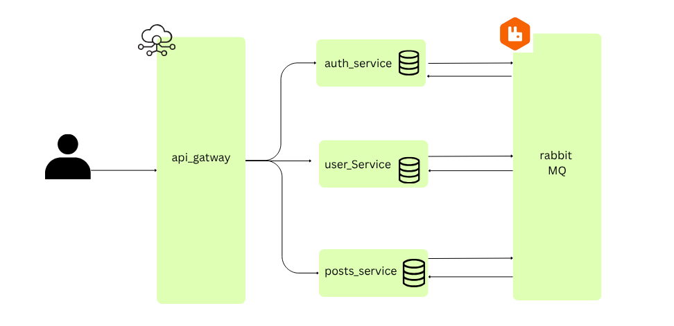

# BlogMicroService

A .NET 10 microservices-based blog application built as a learning/demo project, API composition, JWT authentication, event-driven communication, and database-per-service patterns.

## Overview

This repository contains a lightweight blog platform split into multiple independent services:

- AuthService handles registration, login, JWT issuance, refresh tokens, and authentication flows.
- UserService manages user profiles and user-level operations.
- BlogService manages blog creation, retrieval, update, and deletion.
- ApiGateway exposes the services through Ocelot and centralizes routing.
- Shared contains common JWT configuration and event contracts shared across services.

The solution demonstrates a simple microservice architecture where each service owns its own database and integration events are used to keep related data in sync.

## Architecture



## Services

| Service | Port (HTTPS) | Responsibility |
|---|---:|---|
| ApiGateway | 7286 | Route requests to downstream services via Ocelot |
| AuthService | 7124 | Authentication, JWT, refresh tokens |
| BlogService | 7065 | Blog management |
| UserService | 7248 | User management |
| Shared | n/a | Shared JWT/auth config and event contracts |

## Key technologies

- .NET 10
- ASP.NET Core Web API
- Entity Framework Core
- SQL Server
- RabbitMQ + MassTransit
- Ocelot API Gateway
- JWT Bearer authentication
- Swagger / OpenAPI

## Features

- User registration and login.
- JWT-based authorization using a shared authentication scheme.
- Refresh token support through cookies.
- Blog CRUD operations.
- Filtering / querying blog records.
- User and blog event-driven updates using RabbitMQ.
- Centralized API routing through the gateway.
- Swagger support in each service for local API testing.

## Repository structure

```text
BlogMicroservice/
├── ApiGateway/
│   ├── Program.cs
│   ├── ocelot.json
│   ├── appsettings.json
│   └── Properties/
├── AuthService/
│   ├── Controllers/
│   ├── Database/
│   ├── Dtos/
│   ├── Models/
│   ├── Services/
│   ├── Program.cs
│   └── appsettings.json
├── BlogService/
│   ├── Controllers/
│   ├── Database/
│   ├── Dtos/
│   ├── Models/
│   ├── Repos/
│   ├── Services/
│   ├── Program.cs
│   └── appsettings.json
├── UserService/
│   ├── Controllers/
│   ├── Database/
│   ├── Dtos/
│   ├── Models/
│   ├── Repos/
│   ├── Services/
│   ├── Program.cs
│   └── appsettings.json
├── Shared/
│   ├── Events/
│   └── JwtConfig/
├── BlogMicroservice.slnx
├── .gitignore
└── README.md
```

## Prerequisites

Before running the project, make sure you have:

- .NET 10 SDK installed
- SQL Server available locally (for example SQL Server Express or LocalDB)
- RabbitMQ running locally on localhost with default guest credentials


## Configuration

Each service reads its database and JWT settings from `appsettings.json`.

Example JWT values are configured in the app settings and are intended for local development/demo use:

```json
"JWT": {
  "Key": "ThisIsASecretKeyForJWTTokenGeneration",
  "Issuer": "AuthService",
  "Audience": "AuthServiceUsers"
}
```

The SQL Server connection strings are currently configured with `Server=.`, which typically works on a local SQL Server instance. Update these values if your database is located elsewhere.

## Running the project

### 1. Restore dependencies

```bash
dotnet restore
```

### 2. Start RabbitMQ

Make sure RabbitMQ is running locally. The project uses MassTransit with RabbitMQ on:

- Host: `localhost`
- Username: `guest`
- Password: `guest`

### 3. Start SQL Server

Ensure your local SQL Server instance is running and reachable. The services create and use databases such as:

- `AuthServiceDb`
- `UserDb`
- `BlogDb`


### 4. Run the services

You can run each service separately from the project directory:

```bash
dotnet run --project AuthService/AuthService.csproj
dotnet run --project UserService/UsersService.csproj
dotnet run --project BlogService/BlogService.csproj
dotnet run --project ApiGateway/ApiGateway.csproj
```

The configured local service URLs are:

- AuthService: `https://localhost:7124`
- UserService: `https://localhost:7248`
- BlogService: `https://localhost:7065`
- ApiGateway: `https://localhost:7286`

## API overview

The services are exposed through the API Gateway. Use the gateway base URL for client requests.

### Authentication

- `POST /gateway/auth/register`
- `POST /gateway/auth/login`
- `GET /gateway/auth/refresh`


### Users

- `GET /gateway/users/{id}`
- `PUT /gateway/users/{id}`
- `DELETE /gateway/users/{id}`

### Blogs

- `GET /gateway/blog`
- `GET /gateway/blog/{id}`
- `POST /gateway/blog`
- `PUT /gateway/blog`
- `DELETE /gateway/blog/{id}`

## Authentication flow

The AuthService issues a JWT token and stores a refresh token in an HTTP-only cookie. Client applications can then send the token to protected endpoints through the gateway.

The shared JWT configuration uses the `BlogServiceJwt` authentication scheme and validates:

- Issuer
- Audience
- Token lifetime
- Signing key

## Event-driven communication

This project uses RabbitMQ with MassTransit for asynchronous messaging between services. Examples include:

- User creation events: fired in auth and calls the user service 
- User update events: calls the blog service to update user data
- User deletion events: deletes the user blogs and auth data in auth service


## Notes

- This is primarily a demonstration / learning project.
- Some configuration values are intentionally simple and meant for local development.
- The project may require database creation and migrations depending on your local SQL Server setup.
- The gateway is configured with Ocelot and uses route definitions in `ApiGateway/ocelot.json`.

## Potential next improvements

- Add frontend client (React, Angular, Blazor, etc.)
- Add Docker Compose for all services and dependencies
- Add automated integration tests
- Add FluentValidation and centralized exception handling
- Add health checks and observability
- Improve secrets management for JWT keys and database connection strings

## License

This project is licensed under the MIT License. See the [LICENSE](LICENSE) file for details.
